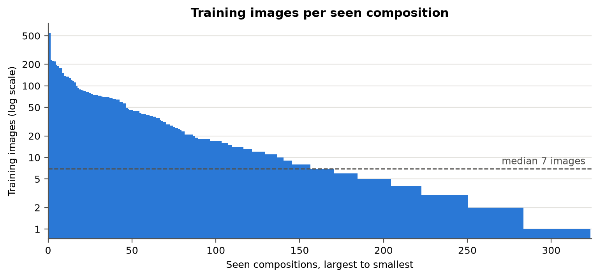
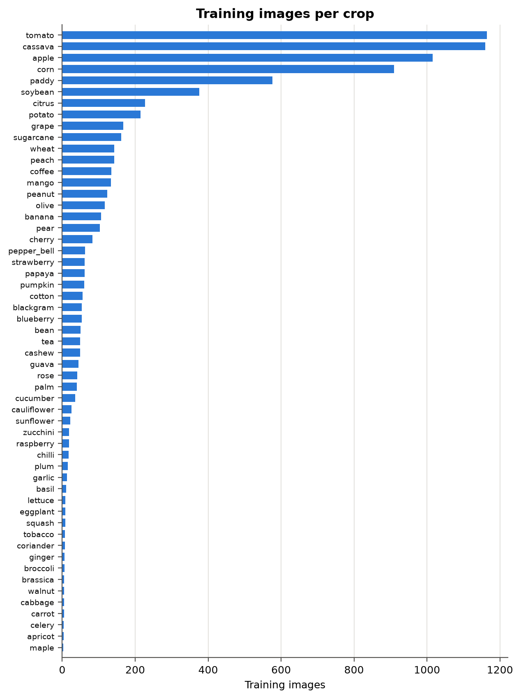
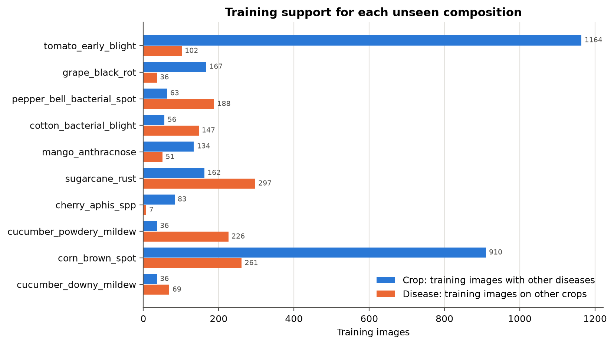
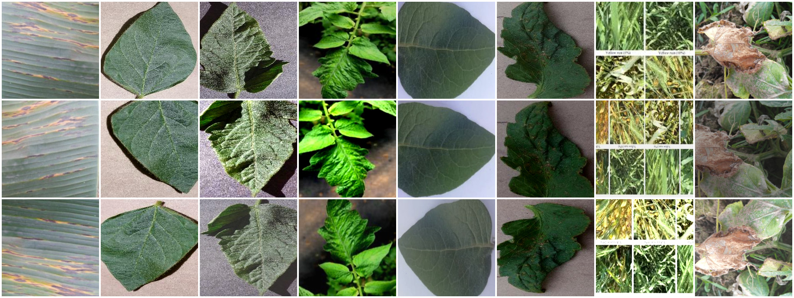

# DPD-Small data exploration

Generated by `python scripts/explore_dataset.py` from the prepared official splits. Do not edit by hand; rerun the script. Full numbers are in [stats.json](stats.json).

## Splits

| Split | Images | Crops | Diseases | Compositions | Source datasets |
|---|---|---|---|---|---|
| train | 8000 | 55 | 175 | 323 | 42 |
| test_seen | 2000 | 55 | 175 | 323 | 43 |
| test_unseen | 1448 | 9 | 10 | 10 | 9 |

The shared validation split takes 1221 training images from 250 compositions, leaving 6779 for training.

All 323 seen compositions appear in both train and seen test. The 10 unseen compositions appear only in unseen test.

## Class imbalance

- Training images per composition range from 1 to 544 (median 7, mean 24.8), a 544:1 ratio.
- 40 compositions have a single training image, 73 have at most two, and 183 of 323 have fewer than ten.
- The 10 largest compositions hold 28.1% of the training set: cassava_mosaic (544), apple_healthy (231), corn_healthy (223), corn_streak_virus (218), citrus_greening (195), ...
- Seen test is just as uneven: 1 to 124 images per composition (median 2); 111 compositions have one test image. Per-class accuracy on those is either 0% or 100%, which is why the evaluation reports both per-class and per-image accuracy.

## Crops and diseases

- 42 diseases occur on more than one crop and 133 on a single crop. Most shared: healthy (37 crops), rust (12 crops), downy_mildew (11 crops), powdery_mildew (11 crops), anthracnose (9 crops), brown_spot (8 crops).
- Crops have 1 to 22 diseases in training (median 4).
- Shared disease names are what make the compositional formulation possible: a disease learnt on one crop has to be recognised on another.

## The 10 unseen compositions

| Composition | Unseen test images | Share | Crop train images (diseases) | Disease train images | Disease seen on crops |
|---|---|---|---|---|---|
| tomato_early_blight | 472 | 32.6% | 1164 (17) | 102 | celery, potato |
| grape_black_rot | 271 | 18.7% | 167 (6) | 36 | apple, brassica, cabbage, cauliflower, coffee |
| pepper_bell_bacterial_spot | 220 | 15.2% | 63 (4) | 188 | cauliflower, papaya, peach, plum, tomato |
| cotton_bacterial_blight | 125 | 8.6% | 56 (5) | 147 | cassava, paddy, soybean |
| mango_anthracnose | 95 | 6.6% | 134 (22) | 51 | banana, blackgram, blueberry, celery, cucumber, papaya, peach, strawberry, tea |
| sugarcane_rust | 89 | 6.1% | 162 (12) | 297 | apple, bean, blueberry, coffee, corn, garlic, guava, peach, peanut, plum, soybean, wheat |
| cherry_aphis_spp | 72 | 5.0% | 83 (3) | 7 | apple, plum |
| cucumber_powdery_mildew | 37 | 2.6% | 36 (5) | 226 | apple, blackgram, cherry, cotton, mango, pepper_bell, pumpkin, squash, tomato, wheat, zucchini |
| corn_brown_spot | 35 | 2.4% | 910 (20) | 261 | apple, cassava, paddy, palm, soybean, sugarcane, tobacco, tomato |
| cucumber_downy_mildew | 32 | 2.2% | 36 (5) | 69 | basil, broccoli, cabbage, cauliflower, grape, lettuce, paddy, rose, soybean, sunflower, zucchini |

- Every unseen crop and disease occurs in training, just never together, so the task is recombining known concepts rather than recognising a completely new disease.
- tomato_early_blight is 32.6% of the unseen test set, so per-image unseen accuracy mostly measures this one class.
- cherry_aphis_spp has the least disease evidence: aphis_spp appears in only 7 training images, on apple, plum.

| Composition | Source datasets of unseen images (training images from that source) |
|---|---|
| tomato_early_blight | CDDM 327 (3073), PWV2 145 (341) |
| grape_black_rot | CDDM 145 (3073), PWV2 114 (341), CUPD 12 (706) |
| pepper_bell_bacterial_spot | CDDM 155 (3073), PWV2 56 (341), CUPD 9 (706) |
| cotton_bacterial_blight | COPD 71 (53), CUPD 54 (706) |
| mango_anthracnose | MLBD 95 (100) |
| sugarcane_rust | SLDD 89 (62) |
| cherry_aphis_spp | PDN 72 (79) |
| cucumber_powdery_mildew | PWV2 37 (341) |
| corn_brown_spot | FP 35 (143) |
| cucumber_downy_mildew | CDRD 32 (27) |

## Source datasets and image properties

Filename prefixes show DPD-Small merges 42 source datasets in training. Largest training sources: CDDM (3073), CUPD (706), CPDD (517), MTID (503), PD (477), PWV2 (341).

36 of 42 sources contain a single crop (3141 training images). Sources usually differ in camera, background and lighting, so a model can recognise the crop from the photo style instead of the plant. Expect crop accuracy to be high and disease accuracy to be the real difficulty; unseen compositions from single-crop sources (for example mango_anthracnose from MLBD) test whether the disease is recognised, not only the source.

Sources that appear only in test: BLD, BLD3, PDL, PDL3.

| Split | Width median (min-max) | Height median (min-max) | Shorter side median | Formats | Colour modes |
|---|---|---|---|---|---|
| train | 448 (89-6000) | 448 (73-5312) | 448 | JPEG 7872, MPO 102, PNG 24, WEBP 2 | RGB 7980, RGBA 20 |
| test_seen | 500 (94-6000) | 500 (92-4752) | 480 | JPEG 1978, MPO 19, PNG 3 | RGB 1997, RGBA 3 |
| test_unseen | 300 (69-5184) | 286.5 (52-4608) | 256 | JPEG 1441, PNG 6, MPO 1 | RGB 1443, RGBA 5 |

Image sizes vary widely and a few images are RGBA, so every model resizes in its input pipeline and converts to RGB. Unseen test images are smaller (median shorter side 256 px against 448 px in train), so a model that has only seen sharp images is also tested on lower resolution. Random-resized-crop augmentation covers part of this. See the preprocessing section of the main README.

## Manual observations

- Not every image is a single leaf photo. CDDM_wheat_healthy_131678.jpg is a collage of figure panels captioned "Yellow rust", yet labelled wheat_healthy. Such images are kept, since the official splits must not change, but they add label noise.

## Preprocessing and augmentation examples

Top row: evaluation preprocessing (resize to 256, centre-crop 224). Lower rows: two random training augmentations of the same images (random resized crop, flips, colour jitter). Images: banana_sigatoka, soybean_healthy, tomato_healthy, tomato_healthy, potato_healthy, tomato_bacterial_spot, wheat_healthy, cucumber_bacterial_wilt.
